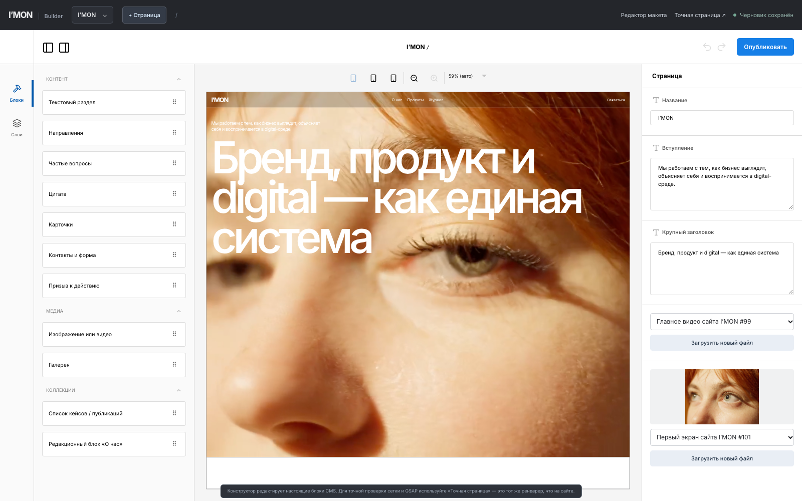

# I’MON Builder — визуальный конструктор (Puck + Payload)

Рабочая ветка `feat/puck-editor-20261021`. Публичный сайт использует существующий Next.js/React-рендерер. Новый конструктор добавлен отдельно и не заменяет сайт.

## Адреса

- `/studio/builder` — визуальный конструктор на основе Puck 0.23.0 (MIT).
- `/studio` — расширенный редактор макета: размеры, сетка, Flex/Grid, отступы, GSAP-анимации, история.
- `/studio/canvas?collection=pages&id=...` — закрытый предпросмотр настоящей версии страницы из Payload.
- `/admin?technical=1` — техническая админка Payload для форматированных статей, глобальных настроек, ролей, заявок.
- Все адреса админок требуют действующей сессии. Публичная навигация к админке отсутствует.

## Что реально работает

- Переключение между существующими страницами, кейсами и публикациями через выпадающий список с поиском.
- Создание новой страницы, кейса или статьи прямо в конструкторе: **только черновик**, публикация отдельно.
- Поля H1 и вступления, редактирование текста в блоках; Drag-and-drop добавление, перестановка, дублирование и удаление блоков; nested arrays с управлением списками.
- Замена локальных изображений и видео через Payload Media, загрузка поддерживаемых форматов.
- Контролы GSAP-появления отдельных секций (fade, rise, scale, parallax, none) и параметры времени, задержки, смещения. В студийных настройках остаются общие адаптивные свойства и параметры grid.
- Автоматическое сохранение **черновика** через защищённый Payload API. Публикация выполняется только после кнопки «Опубликовать» с дополнительным подтверждением.
- Серверная проверка ревизии документа; 409 при параллельном редактировании; сохранение оригинальной структуры других полей (SEO, Lexical, настройки слоёв, связи).
- Undo/redo и адаптивные представления 1440 / 768 / 390 внутри Puck.

## Как работает модель данных

Конвертер `src/studio/puck/adapter.ts` читает структуру `pages.blocks` или `projects.sections` / `articles.sections` и переводит записи в Puck Data, не создавая вторую БД.

После редактирования блоки конвертируются обратно в **те же** Payload block rows, с сохранением ID, порядка, вложенных структур и связей с медиатекой. Конструктор использует метаданные полей непосредственно из Payload schema; появление новых блоков в `src/blocks/content.ts` обновляет Puck registry.

Поля `__motion*` — **виртуальные поля редактора**, в БД как отдельные поля блока не сохраняются. Они записываются в `studio.nodes['block-'+id]` по брейкпоинтам и считываются GSAP на опубликованном сайте. При удалении/копировании блока другой блок не теряет свою конфигурацию.

Редактирование отдельных полей `heroImage` / `heroVideo` использует существующие Payload uploads, исходные `*Path` сохраняются как запасные ссылки.

## Архитектурные ограничения

Встроенный Puck canvas — **не точная копия сложного авторского Framer-дизайна**. Это превью того, как собраны компоненты. Оно должно показывать текст и медиа в понятной геометрии, но точный внешний вид, GSAP и responsive-позиционирование проверяются через «Точная страница», потому что рендерер публичного сайта содержит специализированные асинхронные секции.

Это пока не Framer 1:1: нет произвольной XY-компоновки любого дочернего DOM-элемента, сложного timeline редактора, мультипользовательского live collaboration, общих цветовых/текстовых стилей и графического конструктора произвольных Payload-коллекций.

Цель дальнейших этапов: единый component registry, design tokens, реальные Puck visual adapters для всех редакционных сцен, редактор макро-анимаций, полная визуальная регрессия с исходником. Не заменять исходный дизайн стандартными Puck-компонентами и не переносить AGPL код Revyme без лицензионного решения.

## Проверка

```bash
pnpm check
pnpm test:studio
pnpm build
pnpm start --hostname 127.0.0.1 --port 3120
# Другой терминал, в изолированной базе Studio:
pnpm qa:puck
```

`scripts/qa-puck-flow.mjs` создаёт приватную тестовую страницу в локальной БД, проверяет редактирование, DND, анимацию, явную публикацию, создание новой страницы, а затем удаляет тестовые документы. **Не запускать на production**. Логи и скриншоты (в .gitignore) сохраняются в `audit/puck/`.

Лицензия Puck — MIT. Атрибуция и уведомления об используемых open-source-компонентах должны сохраняться согласно условиям лицензий. Перевод встроенного интерфейса Puck сделан через dictionary и не меняет Puck source.

## Результат браузерного интеграционного теста (21.10.2026)

В Chrome на изолированной базе проверены: приватное создание страницы, редактирование первого экрана, автосохранение, перенос дополнительного блока мышью в iframe, сохранение GSAP rise-параметра в `studio.nodes` (и применение на публичном рендерере), явная публикация без потери существующих блоков, создание следующего неопубликованного документа, загрузка PNG в поле обложки через медиатеку, сохранение связи `heroImage` и удаление обеих тестовых страниц и временного файла. Скрипт `pnpm qa:puck` прошёл с кодом 0.

Важно: корневые поля загрузки разделены по MIME-типам — heroVideo принимает видео, heroImage принимает изображение; превью не подменяет действительный Next.js renderer.

## Скриншот редактора



## Точный предпросмотр внутри конструктора (21.10.2026)

Верхняя панель содержит кнопку **«Точный вид сайта»**. Она сначала сохраняет текущую структуру в закрытый черновик и только после успешного ответа БД переключает рабочую область на настоящий Next.js-рендерер страницы. Для возврата есть кнопка **«Вернуться к редактированию»**. Puck не размонтируется, поэтому доступные операции Undo/Redo и состояние блоков сохраняются. Это не второй макет: используется тот же компонент `/studio/canvas` с черновыми CMS-данными и клиентскими анимациями. Проверено в `pnpm qa:puck` вместе с приватностью, drag-and-drop, публикацией, GSAP и медиа. Такой режим пока **показывает**, а не редактирует сложную геометрию прямо на оригинальной странице; геометрия и motion редактируются в Studio и Puck-инспекторе.
